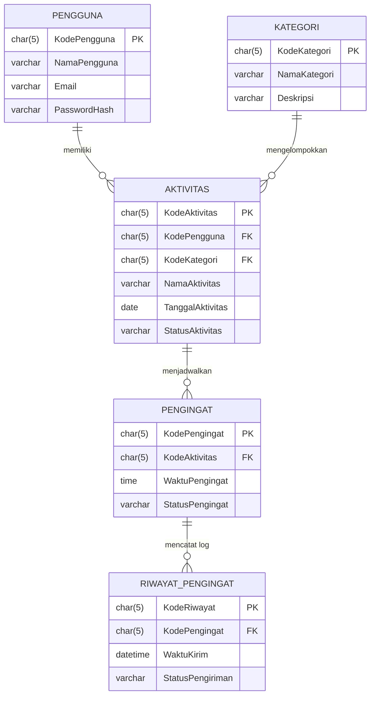

# Dokumentasi Komprehensif Aplikasi ELING
**Smart Daily Reminder with Indonesian Voice & AI Assistant**  
*Mata Kuliah: Implementasi dan Pengujian Perangkat Lunak (IMPAL) — Semester 5*

---

## 1. Pendahuluan & Gambaran Umum

**ELING** adalah aplikasi mobile pengingat aktivitas harian cerdas berbasis Android yang dibangun menggunakan **Flutter** dan **Dart**. Aplikasi ini dirancang khusus untuk mempermudah mahasiswa dan pengguna umum dalam mencatat jadwal tugas, perkuliahan, serta aktivitas pribadi melalui input teks manual maupun perintah suara berbahasa Indonesia (*Speech-to-Text*).

### 🎯 Prinsip Desain Utama
1. **Offline-First (100% Berfungsi Tanpa Internet)**:
   Pencatatan aktivitas, penyimpanan database relasional, dan pemicuan alarm notifikasi tetap berjalan tepat waktu meskipun perangkat dalam kondisi mode pesawat (*airplane mode*).
2. **Kecerdasan Hibrida (AI Proxy + Local Fallback)**:
   Mengekstrak tanggal, jam, judul aktivitas, dan kategori secara otomatis dari kalimat percakapan. Jika ada koneksi ke server, aplikasi menggunakan LLM (Google Gemini). Jika tidak ada internet, algoritma *Rule-Based Heuristic Parser* lokal mengambil alih tugas ekstraksi secara instan di perangkat.
3. **Pemberdayaan Pengguna (Mandatory Human Confirmation)**:
   Seluruh jadwal yang diekstrak oleh AI **tidak pernah langsung dimasukkan ke database**, melainkan wajib ditinjau dan disetujui pengguna melalui lembar konfirmasi (*Confirmation Sheet*).
4. **Keamanan Kunci API (Zero Client Key Exposure)**:
   Tidak ada *API Key* cloud yang disimpan di dalam berkas APK aplikasi mobile.

---

## 2. Anggota Kelompok & Data Akun Pengguna

Database lokal SQLite telah diisi (*auto-seed*) dengan 5 akun anggota kelompok pengembang untuk keperluan demo pengujian IMPAL:

| Kode Pengguna | Nama Anggota | Email | Password Bawaan | Peran |
|:---:|:---|:---|:---:|:---|
| **U0001** | Aziz Faadihilah | `aziz@example.com` | `aziz123` | Anggota Tim 1 |
| **U0002** | Gobes | `gobes@example.com` | `gobes123` | Anggota Tim 2 |
| **U0003** | Riandhika | `riandhika@example.com` | `riandhika123` | Anggota Tim 3 |
| **U0004** | Abied | `abied@example.com` | `abied123` | Anggota Tim 4 |
| **U0005** | Sniper | `sniper@example.com` | `sniper123` | Anggota Tim 5 |

> **Catatan Pengujian**: Pada layar login, terdapat tombol *chip* instan untuk setiap anggota sehingga penguji tidak perlu mengetik email dan password secara manual.

---

## 3. Arsitektur Perangkat Lunak

Aplikasi menggunakan arsitektur **Feature-First Clean Architecture** dengan pemisahan tanggung jawab yang ketat:

```text
lib/
├── app.dart                   # Root router (Pengecekan sesi login pengguna)
├── main.dart                  # Inisialisasi binding, timezone, & DB SQLite
├── core/                      # Komponen inti & modul bersama
│   ├── constants/             # Nama tabel, konstanta saluran notifikasi, kategori
│   ├── database/              # SQLite DatabaseHelper (DDL 5 tabel & migrasi)
│   ├── notifications/         # Layanan notifikasi presisi Android
│   ├── theme/                 # Palet warna, tipografi, dan gaya kartu
│   └── utils/                 # Formatter tanggal/waktu bahasa Indonesia
└── features/                  # Modul fitur berbasis Clean Architecture
    ├── auth/                  # Fitur Autentikasi Pengguna
    │   ├── domain/            # Entity UserAccount
    │   └── presentation/      # AuthNotifier & LoginScreen
    ├── reminders/             # Fitur Inti Manajemen Pengingat
    │   ├── data/              # Model, DataSource SQLite (JOIN 3 tabel), RepositoryImpl
    │   ├── domain/            # Entity Reminder & Category, Repository Interface
    │   └── presentation/      # HomeScreen, ReminderFormScreen, ReminderCard
    ├── settings/              # Panduan Pengaturan & Daya Tahan Baterai
    │   └── presentation/      # BatteryGuideScreen (Bypass OEM & Test Alarm)
    └── voice_ai/              # Fitur Input Suara & Ekstraksi Cerdas
        ├── data/              # SpeechToTextService & AIProxyService (Local Fallback)
        ├── domain/            # ParsedReminderProposal entity
        └── presentation/      # VoiceInputModal, SpeechWaveWidget, AIReviewConfirmationSheet
```

---

## 4. Struktur Database Relasional (5 Tabel)

Basis data relasional diimplementasikan pada SQLite lokal (`eling_database.db` v2) dan juga tersedia berkas dump SQL di `database/db_eling.sql`:



### 📋 Deskripsi Tabel
1. **`pengguna`**: Menyimpan identitas akun, email unik, dan kredensial password.
2. **`kategori`**: Mengelompokkan jenis aktivitas (`K0001` Kuliah, `K0002` Tugas, `K0003` Pribadi, `K0004` Belanja, `K0005` Lainnya).
3. **`aktivitas`**: Menyimpan daftar agenda pengguna yang terikat ke `KodePengguna` tertentu.
4. **`pengingat`**: Menentukan jam pemicu alarm, switch aktif/tidak aktif, dan keterhubungan ke notifikasi sistem Android.
5. **`riwayat_pengingat`**: Mencatat jejak audit pengiriman alarm (berhasil dikirim, dibatalkan, atau ditunda).

---

## 5. Fitur-Fitur yang Telah Selesai Diimplementasikan

| Fitur | Status | Deskripsi |
|---|:---:|---|
| **Multi-User Authentication** | ✅ Selesai | Form login dengan validasi email/password, quick-fill akun 5 anggota, dan pemisahan data pengingat per pengguna. |
| **Penyimpanan Offline SQLite** | ✅ Selesai | Seluruh aktivitas disimpan secara lokal tanpa butuh internet. Data otomatis dimuat saat aplikasi dibuka kembali. |
| **Tab Navigasi Pengingat** | ✅ Selesai | Tab *Hari Ini*, *Mendatang*, dan *Selesai* untuk memilah jadwal yang sudah lewat maupun yang akan datang. |
| **Input Suara (STT Bahasa Indonesia)** | ✅ Selesai | Mengonversi suara pengguna langsung menjadi teks menggunakan locale `id_ID` dengan animasi ripple mikrofon. |
| **Ekstraksi AI & Local Fallback** | ✅ Selesai | Mengubah kalimat alami (contoh: *"ingatkan kuis matematika besok jam sembilan pagi"*) menjadi judul, tanggal, jam, dan kategori tugas. Tetap bekerja saat offline. |
| **Lembar Tinjauan AI (Human Confirmation)** | ✅ Selesai | Pengguna dapat mengedit kembali judul, tanggal, dan jam sebelum jadwal disimpan ke SQLite. |
| **Alarm Notifikasi Presisi** | ✅ Selesai | Menggunakan `flutter_local_notifications` dengan mode `exactAllowWhileIdle` dan receiver boot otomatis. |
| **Panduan Baterai OEM & Uji Alarm** | ✅ Selesai | Menyediakan tutorial izin background untuk HP Xiaomi/Samsung/Oppo serta tombol uji alarm 10 detik. |
| **Unit & Widget Testing (12/12 Passed)** | ✅ Selesai | Pengujian otomatis skenario IMPAL mencakup serialisasi model, parser bahasa Indonesia, fallback ekstraksi, dan UI. |

---

## 6. Analisis Kekurangan & Hal yang Masih Perlu Ditingkatkan (What's Missing)

Meskipun aplikasi sudah berfungsi utuh dan memenuhi kriteria proyek tugas besar IMPAL, berikut adalah hal-hal yang **belum diimplementasikan / masih dapat ditingkatkan** untuk pengembangan selanjutnya:

### 1. Form Registrasi Pengguna Baru di Antarmuka (*Register Screen UI*)
- **Kondisi Saat Ini**: Aplikasi sudah memiliki 5 akun anggota yang di-seed di SQLite. Pengguna login menggunakan salah satu dari 5 akun tersebut.
- **Kekurangan**: Belum ada tombol "Daftar Akun Baru" pada antarmuka login jika ada pengguna ke-6 yang ingin mendaftar secara mandiri melalui aplikasi.
- **Solusi Selanjutnya**: Tambahkan `lib/features/auth/presentation/screens/register_screen.dart` yang menerima input nama, email, password, lalu melakukan `INSERT INTO pengguna` dengan auto-generate `KodePengguna` (misal: `U0006`).

### 2. Sinkronisasi Cloud ke Server PostgreSQL Terpusat (*Cloud Data Sync*)
- **Kondisi Saat Ini**: Aplikasi berjalan 100% *Offline-First* di SQLite lokal HP masing-masing. Berkas SQL dump PostgreSQL sudah tersedia di `database/db_eling.sql`.
- **Kekurangan**: Jika anggota kelompok login di HP yang berbeda, data pengingat belum saling tersinkronisasi secara real-time antar perangkat melalui internet.
- **Solusi Selanjutnya**: Jika dosen menghendaki database online terpusat, hubungkan `server/index.js` ke database PostgreSQL (misalnya di Supabase/Render), lalu tambahkan logika sinkronisasi data (*Sync Worker*) di Flutter saat perangkat tersambung internet.

### 3. Kustomisasi Tambah Kategori Baru dari Aplikasi
- **Kondisi Saat Ini**: Tabel `kategori` sudah berisi 5 kategori standar (Kuliah, Tugas, Pribadi, Belanja, Lainnya).
- **Kekurangan**: Pengguna belum bisa membuat kategori baru dengan warna dan nama kustom langsung dari layar HP.
- **Solusi Selanjutnya**: Buat dialog kelola kategori di halaman pengaturan untuk mengeksekusi `INSERT INTO kategori`.

### 4. Pengingat Berulang (*Recurring Reminders*)
- **Kondisi Saat Ini**: Alarm dipicu sekali (*one-time exact alarm*) pada tanggal dan jam yang ditentukan.
- **Kekurangan**: Belum ada opsi jadwal berulang seperti *Setiap Hari*, *Setiap Hari Senin*, atau *Setiap Bulan*.
- **Solusi Selanjutnya**: Menambahkan field `is_recurring` dan memanfaatkan `matchDateTimeComponents: DateTimeComponents.dayOfWeekAndTime` pada konfigurasi `flutter_local_notifications`.

### 5. Fitur Ubah Password & Manajemen Profil
- **Kondisi Saat Ini**: Profil menampilkan nama pengguna yang sedang aktif dengan tombol Logout.
- **Kekurangan**: Belum ada layar untuk mengedit nama pengguna, mengganti foto profil, atau memperbarui kata sandi akun.
